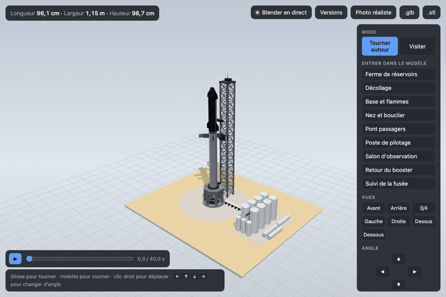

# ModelForge

Tu décris un objet en langage courant (« un Airbus A350 avec une cabine que je peux
visiter », « une maison de plain-pied meublée », « un robot de 30 cm »). Un agent pose
les questions utiles, puis le modélise dans Blender. Le résultat s'affiche dans le
navigateur : tu tournes autour, tu le coupes en deux, tu entres dedans.



| Animation | Coupe |
|---|---|
|  |  |

## Lancer

```
.venv/bin/python -m modelforge
```

(ou double-clic sur `lancer.command`). L'app s'ouvre sur http://127.0.0.1:8765.

Il faut : Blender installé dans `/Applications` (ou `BLENDER_PATH=/chemin/vers/blender`),
et Claude Code connecté (`claude` puis `/login`) : l'agent utilise ton propre compte.
À défaut, une clé API dans la variable `ANTHROPIC_API_KEY` convient aussi.

Première installation sur une autre machine :

```
uv venv --python 3.13 .venv
uv pip install --python .venv/bin/python -e .
(cd web && npm install)
```

## Utiliser

| Dans la visionneuse | Ce que ça fait |
|---|---|
| Glisser, molette | Tourner autour, zoomer |
| Vues (Avant, Gauche, Dessus…) et flèches du clavier | Changer d'angle |
| Entrer dans le modèle | Boutons créés par l'agent (Cabine, Cockpit, Salon…) : téléportation à l'intérieur |
| Visiter | Z Q S D pour marcher, glisser pour tourner la tête, Espace / C pour monter / descendre, Maj pour aller vite, Échap pour ressortir |
| Coupe | Retire une tranche du modèle (largeur, longueur ou hauteur) pour voir dedans |
| Voir la fabrication dans Blender | Ouvre Blender en direct (voir ci-dessous) |

Dans le chat, tu peux donner une taille (« 2 m de long », « au 1/100 ») : le modèle est
mis à l'échelle, proportions conservées, et ses dimensions s'affichent en haut à gauche.
Ensuite tu demandes des retouches en langage courant (« sièges en rouge », « ajoute un
garage »).

## Voir la fabrication dans Blender

Par défaut, Blender travaille sans fenêtre : tu ne vois que le résultat dans le
navigateur. Le bouton **Voir la fabrication dans Blender** (en haut à droite) ouvre un
Blender relié à l'agent ; le voyant passe au vert (« Blender en direct »). Tant que ce
Blender reste ouvert, l'agent construit dedans : les pièces apparaissent une à une, et tu
navigues avec les contrôles de Blender. Le chat reste dans le navigateur, qui continue
d'afficher le modèle après chaque passe.

- Ferme ce Blender : l'agent repasse tout seul en mode sans fenêtre.
- Un Blender ouvert à la main (depuis le Dock) n'est pas relié : passe par le bouton.
- Tu peux retoucher le modèle à la main dans Blender, mais enregistre (Cmd+S) avant de
  redemander quelque chose à l'agent, et sache qu'une passe complète de l'agent
  reconstruit tout le modèle : préviens-le dans le chat de ce que tu as changé.
- Si une passe échoue, la scène revient à son dernier état enregistré.

## Aller plus loin

- **Image de référence** : bouton « ＋ Image » sous le chat (ou colle l'image, ou
  glisse-la sur le chat). L'agent s'en sert pour les proportions et les couleurs.
- **Photo réaliste** : bouton en haut à droite. Blender rend ce que tu vois dans la
  visionneuse avec ciel, soleil, ombres et reflets (environ 10 s). L'image arrive
  dans le chat et dans le dossier `photos/` du projet.
- **Vue éclatée** : curseur du panneau de droite, qui écarte les pièces les unes des
  autres puis les rassemble. C'est un effet de la visionneuse : le modèle n'est pas modifié.
- **Désigner une pièce** : clique sur une pièce dans la visionneuse (un cadre orange
  l'entoure), puis écris ce que tu veux changer : « mets-la en rouge », « plus haute ».
- **Versions** : bouton en haut à droite. Chaque modification de l'agent est gardée
  (les 40 dernières) ; clique sur une version pour la revoir, puis « Revenir à cette
  version » si tu la préfères. Les versions plus récentes restent dans la liste.
- **Animation** : demande du mouvement (« anime le décollage », « ouvre la porte ») ;
  un lecteur apparaît en bas de la visionneuse, avec lecture, pause et curseur.
  La photo réaliste prend l'instant affiché.
- **Rapide / Soigné** : en haut du chat. « Soigné » laisse l'agent réfléchir plus
  longtemps, pour les objets complexes (plus lent, consomme plus). Réglage par projet.
- **Impression 3D** : bouton « .stl » en haut à droite (fichier en millimètres).
- **Un projet par objet** : si tu demandes un objet sans rapport avec celui du projet,
  l'agent ouvre un nouveau projet au lieu d'écraser l'ancien.

## Comment ça marche

```
navigateur (web/)  ──WebSocket──  serveur (modelforge/server.py)
                                      │
                                  agent Claude (modelforge/agent.py)
                                      │  outils : poser_questions · modeliser · regarder
                                  Blender en direct (modelforge/blender/live.py) s'il est ouvert,
                                  sinon Blender sans interface (modelforge/blender/runner.py)
                                      │
                 projects/<id>/  scene.blend · model.glb · previews/ · scripts/
```

1. L'agent écrit du code Python de modélisation ; il dispose d'une petite boîte à outils
   (`modelforge/blender/afkit.py` : fuselages par sections, ailes profilées, coque creuse,
   copies légères, découpes, points de vue, mise à l'échelle).
2. Blender l'exécute, enregistre la scène, exporte un `.glb` et renvoie à l'agent les
   dimensions, la liste des pièces et des images sous plusieurs angles.
3. L'agent regarde ces images, corrige, et recommence jusqu'à ce que le modèle soit bon.
4. La visionneuse (three.js) recharge le `.glb` à chaque passe.

Chaque projet garde l'historique de ses scripts dans `projects/<id>/scripts/` : le
dernier script complet permet de reconstruire le modèle.

## Réglages

| Variable | Rôle | Défaut |
|---|---|---|
| `MODELFORGE_MODEL` | Modèle Claude de l'agent | `claude-opus-5-5` |
| `MODELFORGE_EFFORT` | Effort de réflexion (`low` à `max`) : plus haut = plus soigné mais plus lent | `medium` |
| `BLENDER_PATH` | Exécutable Blender | détection automatique |

## À savoir

L'agent exécute sur ta machine, dans Blender, du code Python qu'il écrit lui-même. Le
serveur n'écoute que sur `127.0.0.1` et refuse les requêtes venant d'autres sites, et
l'agent n'a ni terminal ni accès aux fichiers en dehors de Blender ; mais ce code tourne
avec tes droits. À utiliser en local, pas à exposer sur un réseau.

## Licence

MIT, voir [LICENSE](LICENSE).
