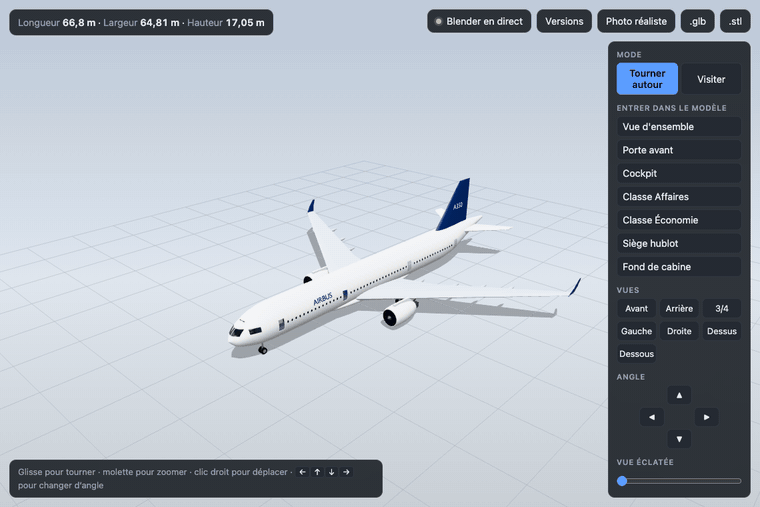

# ModelForge

ModelForge transforme une description en langage courant en modèle 3D. Un agent IA pose
les questions utiles, modélise l'objet dans Blender, contrôle son propre travail sur des
rendus, puis affiche le résultat dans une visionneuse web : rotation, coupe, vue éclatée,
animation et visite de l'intérieur.

Exemples de demandes : « un Airbus A350 avec une cabine visitable », « une maison de
plain-pied meublée », « un robot de 30 cm ».

**[Galerie en ligne](https://rogz10.github.io/modelforge/)** : quatre modèles générés, à explorer dans le
navigateur sans rien installer.


| Animation | Coupe |
|---|---|
|  |  |

## Fonctionnalités

- **Modélisation par conversation** : description, questions de l'agent, puis retouches
  en langage courant (« sièges en rouge », « ajoute un garage »).
- **Dimensions réelles** : une taille peut être imposée (« 2 m de long », « au 1/100 ») ;
  le modèle est mis à l'échelle, proportions conservées.
- **Visionneuse web** : rotation, vues prédéfinies, coupe, vue éclatée, visite à la
  première personne, lecteur d'animation.
- **Blender en direct** : la construction peut être suivie pièce par pièce dans une
  fenêtre Blender.
- **Exports** : `.glb` (couleurs et animation), `.stl` pour l'impression 3D, rendu photo
  réaliste.
- **Historique** : chaque modification est conservée et peut être restaurée.

## Prérequis

- macOS (seule plateforme testée) ;
- [Blender](https://www.blender.org/) installé dans `/Applications`, ou son chemin dans
  la variable `BLENDER_PATH` ;
- Python 3.11 ou plus récent, [uv](https://docs.astral.sh/uv/) et Node.js ;
- un accès à Claude : Claude Code connecté (`claude` puis `/login`), ou une clé API dans
  la variable `ANTHROPIC_API_KEY`. Chaque utilisateur se sert de son propre compte.

## Installation

```
git clone https://github.com/rogz10/modelforge.git
cd modelforge
uv venv --python 3.13 .venv
uv pip install --python .venv/bin/python -e .
(cd web && npm install)
```

## Lancement

```
.venv/bin/python -m modelforge
```

L'application s'ouvre sur http://127.0.0.1:8765. Sur macOS, un double-clic sur
`lancer.command` fait la même chose.

## Utilisation

### Visionneuse

| Commande | Effet |
|---|---|
| Glisser, molette | Tourner autour du modèle, zoomer |
| Vues (Avant, Gauche, Dessus…) et flèches du clavier | Changer d'angle |
| Entrer dans le modèle | Boutons créés par l'agent (Cabine, Cockpit, Salon…) : téléportation à l'intérieur |
| Visiter | Z Q S D pour marcher, glisser pour tourner la tête, Espace / C pour monter / descendre, Maj pour accélérer, Échap pour ressortir |
| Coupe | Retire une tranche du modèle (largeur, longueur ou hauteur) pour voir l'intérieur |
| Vue éclatée | Écarte les pièces les unes des autres, puis les rassemble ; le modèle n'est pas modifié |
| Clic sur une pièce | La désigne (cadre orange) ; la demande suivante dans le chat porte sur elle |

### Chat

- **Image de référence** : bouton « ＋ Image », collage ou glisser-déposer. L'agent s'en
  sert pour les proportions et les couleurs.
- **Animation** : une demande de mouvement (« anime le décollage », « ouvre la porte »)
  fait apparaître un lecteur sous la visionneuse.
- **Rapide / Soigné** : « Soigné » laisse l'agent réfléchir plus longtemps, pour les
  objets complexes (plus lent, consommation plus élevée). Réglage propre à chaque projet.
- **Un projet par objet** : une demande sans rapport avec l'objet en cours ouvre un
  nouveau projet au lieu d'écraser le précédent.

### Barre d'outils

- **Versions** : les 40 dernières modifications sont conservées. Un clic affiche une
  version, « Revenir à cette version » la restaure.
- **Photo réaliste** : Blender rend la vue affichée avec ciel, soleil, ombres et reflets
  (environ 10 s). L'image arrive dans le chat et dans le dossier `photos/` du projet.
  Pour un modèle animé, l'instant affiché est celui du rendu.
- **.glb / .stl** : téléchargement du modèle 3D, ou du fichier d'impression 3D (en
  millimètres).

### Suivre la fabrication dans Blender

Par défaut, Blender travaille sans fenêtre et seul le résultat s'affiche dans le
navigateur. Le bouton **Voir la fabrication dans Blender** ouvre un Blender relié à
l'agent ; le voyant passe au vert. Tant que cette fenêtre reste ouverte, l'agent y
construit le modèle pièce par pièce. Le chat reste dans le navigateur.

- Fermer ce Blender fait revenir l'agent au mode sans fenêtre.
- Un Blender ouvert autrement (depuis le Dock) n'est pas relié à l'agent.
- Le modèle peut être retouché à la main dans Blender. Il faut alors enregistrer (Cmd+S)
  avant la demande suivante et signaler le changement dans le chat : une passe complète
  de l'agent reconstruit tout le modèle.
- Si une passe échoue, la scène revient à son dernier état enregistré.

## Architecture

```
navigateur (web/)  ──WebSocket──  serveur (modelforge/server.py)
                                      │
                                  agent Claude (modelforge/agent.py)
                                      │  outils : poser_questions · modeliser · regarder
                                  Blender en direct (modelforge/blender/live.py) s'il est ouvert,
                                  sinon Blender sans interface (modelforge/blender/runner.py)
                                      │
                 projects/<id>/  scene.blend · model.glb · previews/ · scripts/
```

1. L'agent écrit du code Python de modélisation. Il dispose d'une boîte à outils
   (`modelforge/blender/afkit.py`) : fuselages par sections, ailes profilées, coques
   creuses, copies légères, découpes, matériaux, animation, points de vue.
2. Blender exécute ce code, enregistre la scène, exporte un `.glb` et renvoie à l'agent
   les dimensions, la liste des pièces et des rendus sous plusieurs angles.
3. L'agent examine ces rendus, corrige, et recommence jusqu'à obtenir un modèle correct.
4. La visionneuse (three.js) recharge le `.glb` après chaque passe.

Chaque projet conserve ses scripts dans `projects/<id>/scripts/` : le dernier script
complet suffit à reconstruire le modèle.

## Évaluation de l'agent

Un banc d'évaluation joue une série de demandes fixes (`bench/cases.json`, 20 cas : mug,
table, voiture, maison visitable, fusée animée…) sans interface, et mesure pour chacune :

- si un modèle a été produit ;
- si les exigences de la demande sont respectées (dimensions à 5 % près, nombre de
  pièces, animation, points de vue) ;
- le nombre de passes Blender, dont celles en échec (erreur dans le code généré) ;
- la durée et le coût estimé.

```
.venv/bin/python -m modelforge.bench                    # tous les cas
.venv/bin/python -m modelforge.bench --cases mug,table  # certains cas
.venv/bin/python -m modelforge.bench --effort high --name soigne
```

Les résultats sont écrits dans `bench/runs/<nom>/` (`results.md`, `results.json`, et un
projet par cas). Chaque cas lance une vraie session de l'agent : un passage complet dure
plusieurs minutes par cas et consomme du forfait Claude ou des crédits API. Les questions
de l'agent reçoivent une réponse automatique (« choisis la réponse recommandée »).

## Galerie

La galerie est une page statique, dans `docs/`, servie par GitHub Pages. Pour y ajouter
un modèle ou la mettre à jour après un changement de la visionneuse :

```
.venv/bin/python -m modelforge.gallery ID_DU_PROJET="Titre affiché"
```

## Configuration

| Variable | Rôle | Défaut |
|---|---|---|
| `MODELFORGE_MODEL` | Modèle Claude utilisé par l'agent | `claude-opus-5-5` |
| `MODELFORGE_EFFORT` | Effort de réflexion (`low` à `max`) : plus élevé = plus soigné, plus lent | `medium` |
| `BLENDER_PATH` | Exécutable Blender | détection automatique |

## Sécurité

L'agent exécute sur la machine, dans Blender, du code Python qu'il écrit lui-même. Le
serveur n'écoute que sur `127.0.0.1` et refuse les requêtes provenant d'autres sites ;
l'agent n'a ni terminal ni accès aux fichiers en dehors de Blender. Ce code s'exécute
néanmoins avec les droits de l'utilisateur : ModelForge est prévu pour un usage local et
ne doit pas être exposé sur un réseau.

## Licence

MIT, voir [LICENSE](LICENSE).
